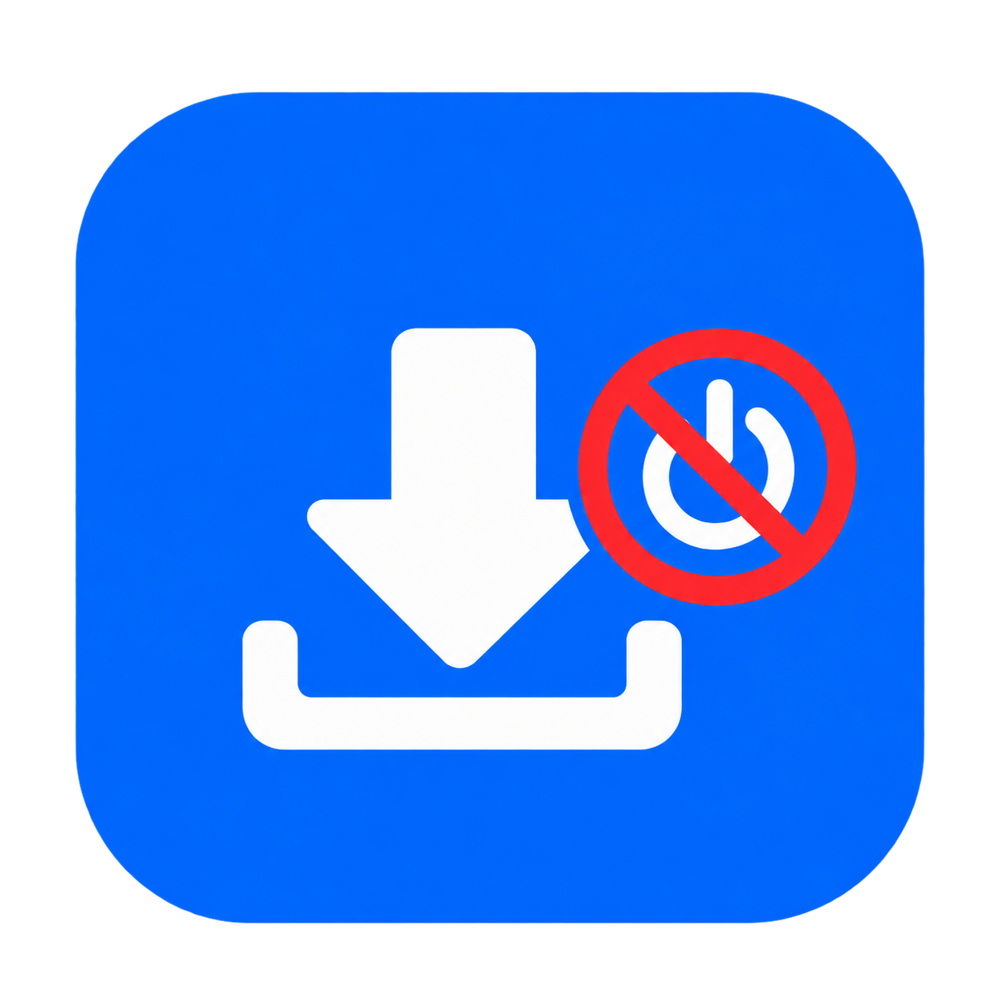

# Samsung Download Exit

<p align="center">
  
</p>

أداة Windows مجانية ومفتوحة المصدر لإعادة تشغيل أجهزة Samsung والخروج من **Download Mode** عندما يكون زر Power تالفًا أو غير متاح.

> الأداة لا تفلش Firmware، ولا تفتح Bootloader، ولا تمسح البيانات. وظيفتها الوحيدة هي بدء جلسة Samsung/Odin ثم إنهاؤها مع طلب Reboot.

## تنزيل النسخة الجاهزة

نزّل أحدث إصدار من صفحة [Releases](https://github.com/magawry50-ctrl/samsung-download-exit/releases/latest)، ثم شغّل `Samsung Download Exit.exe`.

### المتطلبات

- Windows 10 أو Windows 11 بنواة x64.
- كابل USB يدعم نقل البيانات.
- جهاز Samsung موجود في Download Mode.
- تعريف WinUSB في أول استخدام على كل كمبيوتر جديد، كما هو موضح أدناه.

## الاستخدام اليومي

بعد إعداد التعريف لأول مرة:

1. اضغط مطولًا على `Volume Up + Volume Down`.
2. وصّل الجهاز بالكمبيوتر حتى تظهر شاشة Download Mode.
3. افتح `Samsung Download Exit.exe`.
4. انتظر حتى تظهر حالة **الجهاز جاهز**.
5. اضغط الزر الأخضر **إعادة تشغيل الجهاز والخروج من Download Mode**.
6. افصل الكابل بعد ظهور شعار Samsung.

يمكنك عادةً استخدام أي منفذ USB على الكمبيوتر نفسه، ولا تحتاج إلى Zadig في كل مرة.

## إعداد WinUSB لأول مرة باستخدام Zadig

الاتصال منخفض المستوى يحتاج تعريف **WinUSB**. هذه الخطوات مطلوبة **مرة واحدة فقط على كل كمبيوتر Windows جديد**:

1. نزّل [Zadig من الموقع الرسمي](https://zadig.akeo.ie/) وشغّله كمسؤول.
2. من قائمة **Options** فعّل **List All Devices**.
3. اختر جهاز Samsung فقط. على Galaxy Tab S7 ظهر لدينا باسم `SM8250` وبالمعرّف `04E8:685D`.
4. تأكد أن التعريف الجديد في الجهة اليمنى هو **WinUSB**.
5. اضغط **Replace Driver** أو **Install Driver** وانتظر رسالة النجاح.
6. افتح Samsung Download Exit واضغط **إعادة فحص الاتصال**.

### تنبيه مهم

لا تختر فلاشة USB أو لوحة مفاتيح أو أي جهاز آخر داخل Zadig. تحقق من أن Vendor ID هو `04E8` الخاص بـSamsung. تغيير التعريف يخص وضع Download Mode فقط، لكنه قد يجعل Odin الرسمي لا يرى الجهاز حتى تستعيد تعريف Samsung.

## استعادة تعريف Samsung لاستخدام Odin

إذا احتجت Odin الرسمي لاحقًا:

1. افصل جهاز Samsung.
2. افتح **Device Manager**.
3. احذف جهاز WinUSB الخاص بـSamsung فقط، مع اختيار حذف التعريف إذا ظهر الخيار.
4. ثبّت أحدث **Samsung USB Driver** الرسمي.
5. أعد توصيل الجهاز.

بعد استعادة تعريف Samsung، قد تحتاج إلى تكرار إعداد WinUSB قبل استخدام هذه الأداة مرة أخرى.

## حل المشكلات

### الجهاز غير متصل

- تأكد أن الجهاز في Download Mode وليس شاشة الشحن.
- استخدم كابل بيانات آخر أو منفذ USB مختلفًا.
- افصل برامج Samsung/Odin الأخرى حتى لا تحجز اتصال USB.
- اضغط **إعادة فحص الاتصال**.

### تعريف USB مطلوب

- نفّذ خطوات Zadig السابقة.
- تحقق من `VID:PID` وهو غالبًا `04E8:685D`.
- إذا غيّر Windows التعريف بعد تحديث أو إعادة تثبيت Samsung USB Driver، أعد إعداد WinUSB.

### تعذّر بدء بروتوكول Samsung/Odin

- أغلق Odin وSmart Switch وأي برنامج صيانة هواتف.
- افصل الكابل، أعد الدخول إلى Download Mode، ثم أعد المحاولة.
- جرّب منفذ USB مباشرًا بدل موزع USB Hub.

## الأجهزة والتعريفات المدعومة

تبحث الأداة عن Samsung Vendor ID `04E8` ومعرّفات Download Mode التالية:

- `6601`
- `685D` — المستخدم في Galaxy Tab S7 الذي اختُبرت عليه الأداة.
- `68C3`

قد تعمل على أجهزة Samsung إضافية تستخدم أحد هذه المعرّفات، لكن الاختبار الفعلي تم على Galaxy Tab S7.

## البناء من المصدر

يتطلب .NET 10 SDK:

```powershell
dotnet publish .\SamsungDownloadExit\SamsungDownloadExit.csproj -c Release -r win-x64 --self-contained true
```

أو شغّل:

```powershell
.\build-release.ps1
```

الناتج المستقل يوجد في مجلد `Release`. لا يحتاج المستخدم إلى تثبيت .NET.

## كيف تعمل الأداة؟

تستخدم الأداة libusb لإجراء مصافحة `ODIN`/`LOKE`، ثم ترسل حزم بدء الجلسة وإنهائها وطلب إعادة التشغيل. لا توجد أي حزمة Flash داخل مسار التشغيل.

## الخصوصية

- لا تجمع الأداة أي بيانات.
- لا تتصل بالإنترنت.
- لا ترسل رقمًا تسلسليًا أو معلومات عن الجهاز.
- كل الاتصال يتم محليًا عبر USB.

## المصدر والترخيص

- المشروع مرخّص تحت [MIT License](LICENSE).
- تنفيذ حزم Odin مبني على التوثيق العملي في [Heimdall](https://github.com/Benjamin-Dobell/Heimdall) المرخّص MIT.
- الاتصال بـUSB يتم عبر [LibUsbDotNet](https://github.com/LibUsbDotNet/LibUsbDotNet) وlibusb. راجع [THIRD-PARTY-NOTICES.md](THIRD-PARTY-NOTICES.md).

الأيقونة مقدمة من مالك المشروع ومضمّنة في المصدر والإصدار التنفيذي.
